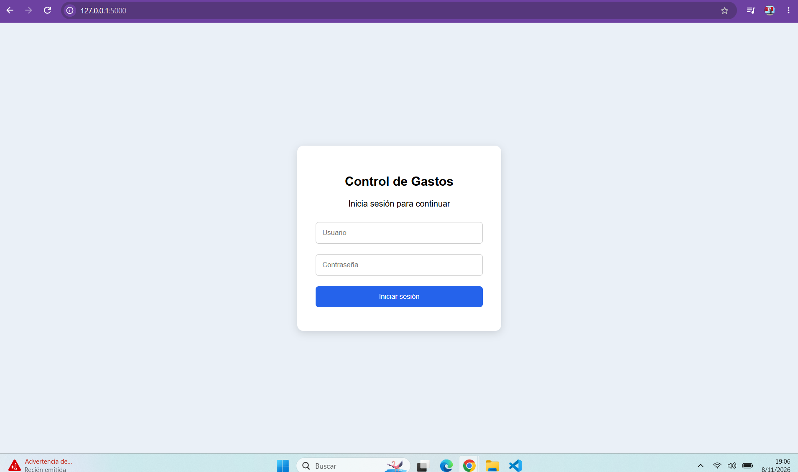
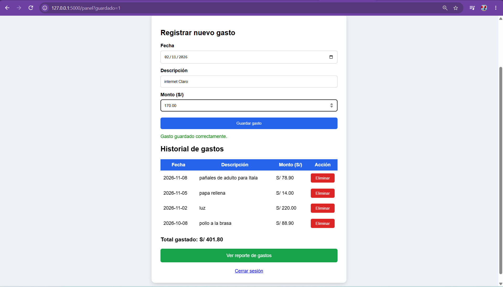
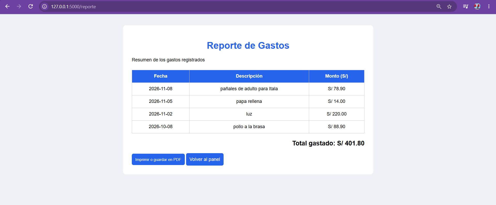
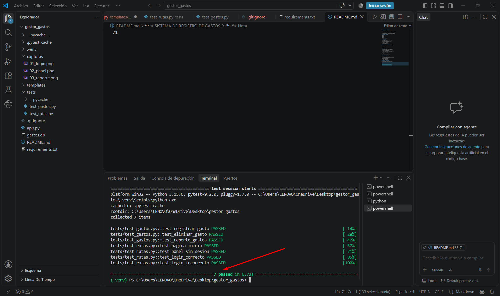

# SISTEMA DE REGISTRO DE GASTOS

## Descripción del proyecto

Aplicación web desarrollada con Python, Flask y SQLite.

Permite iniciar sesión, registrar gastos, visualizar
el historial, eliminar registros y generar reportes.

## Tecnologías utilizadas

- Python
- Flask
- SQLite
- HTML y CSS
- Pytest
- Visual Studio Code

## Funcionalidades

1. Inicio de sesión.
2. Registro de fecha, descripción y monto.
3. Almacenamiento de gastos en SQLite.
4. Visualización del historial.
5. Eliminación de gastos.
6. Cálculo del total acumulado.
7. Generación de reportes.
8. Impresión o exportación del reporte a PDF.

## Credenciales de demostración

Usuario: admin

Contraseña: 123

## Instalación

1. Descargar el proyecto desde GitHub.
2. Abrir la carpeta en Visual Studio Code.
3. Crear un entorno virtual de Python.
4. Instalar las dependencias:

    python -m pip install -r requirements.txt

5. Ejecutar la aplicación:

    python app.py

6. Abrir http://127.0.0.1:5000

## Pruebas automatizadas

El proyecto utiliza pytest para comprobar
el funcionamiento de sus principales funciones.

Para ejecutar las pruebas:

    python -m pytest -v

## Capturas de la aplicación

### 1. Inicio de sesión

El sistema permite ingresar con las credenciales
del administrador.

### 2. Registro de gastos

Permite registrar fecha, descripción y monto,
visualizar los gastos y eliminarlos.

### 3. Reporte de gastos

Muestra los gastos registrados, calcula el total
y permite imprimir o guardar el reporte en PDF.

### 4. Pruebas automatizadas

Se realizaron siete pruebas con pytest,
todas ejecutadas correctamente.

## Nota

Proyecto académico de demostración.
No utilizar las credenciales de ejemplo
para almacenar información privada real.
